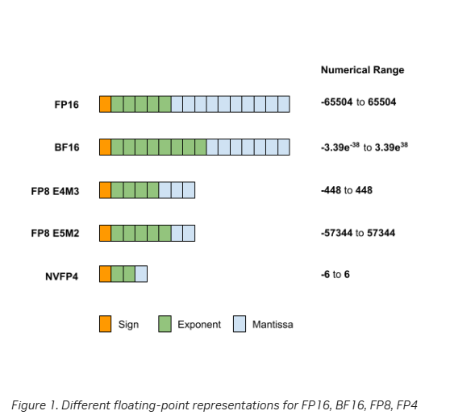
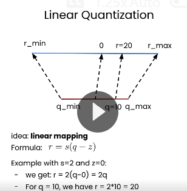
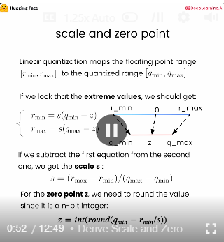
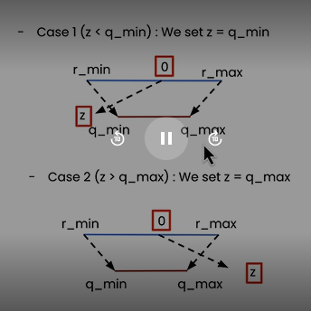
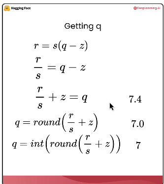
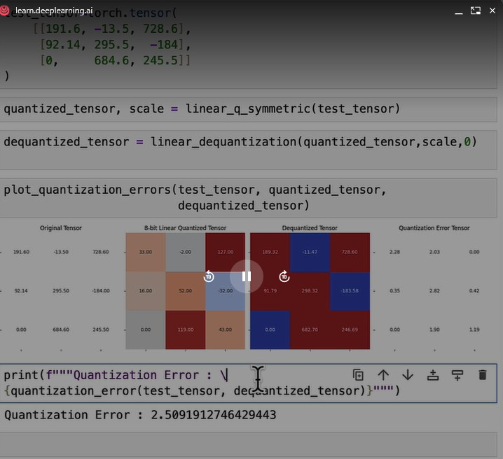
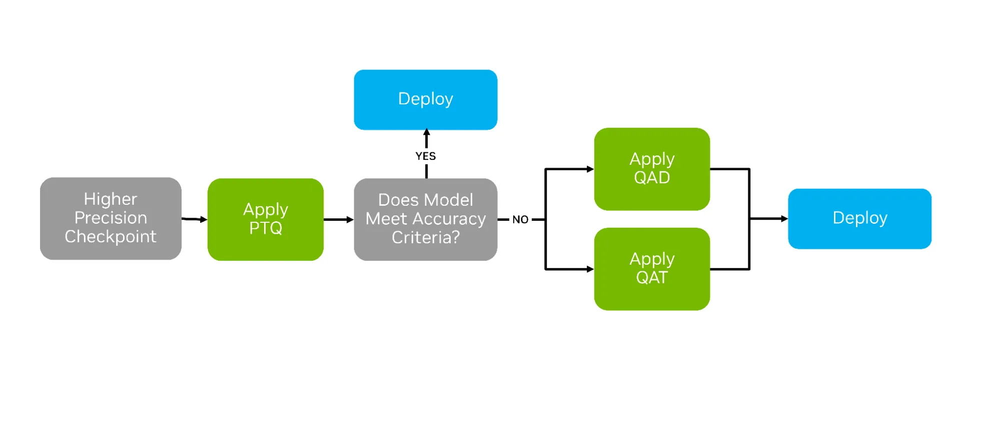
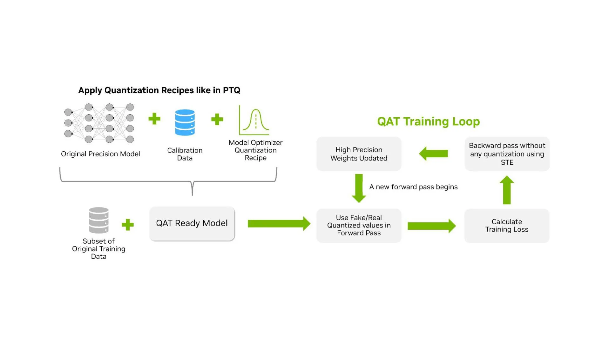
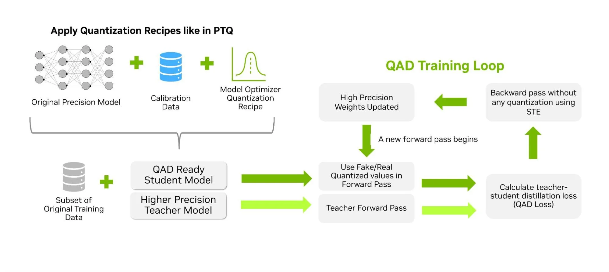

# Understanding LLM Quantization

## 1. Model optimization in context

Quantization methods reduce the storage and, in some cases, computation required by a model.

- **Quantization:** Represent model parameters with lower-precision values.
- **Knowledge distillation:** Train a student model to reproduce useful behavior from a teacher model.
- **Pruning:** Remove selected weights or connections, often to create a sparse model.

Many quantization methods can be applied across model types, but support depends on the operators, model architecture, quantization method, and runtime.

## 2. Numerical precision

Quantization changes how model values are represented. For example:

- `FP32`: example values include `-234.1` and `251.51`.
- `INT8`: integer range from `-128` to `127`.
- Example conversion: `torch.float32` to `torch.int8`.

Several floating-point formats can be used to represent a model’s parameters:

- **Sign:** This single bit indicates the sign of the number, `0` for positive and `1` for negative.
- **Exponent:** This portion encodes the exponent, representing the power to which the base (commonly 2 in binary systems) is raised and defines the range of the datatype.
- **Significand/mantissa:** This represents the significant digits of the number. The precision of the number heavily depends on the length of the significand.

The formula used for this representation is:

```text
x = (-1)^sign * 2^exponent * mantissa
```



Quantization maps floating-point value `x` in `[α, β]` to a low-precision value `x_q` in `[α_q, β_q]`. For example, when mapping FP16 floating-point value `x` to the FP8 E4M3 (4-bit exponent, 3-bit mantissa) format `x_q`, the approximate range of representable values is:

```text
x in [-65504, 65504]
```

```text
x_q in [-448, 448]
```

## 3. Why quantization is needed

Quantization lowers the memory requirements of loading and using a model by storing the weights in a lower precision while trying to preserve as much accuracy as possible.

As AI models—especially generative AI models—grow in size and computational demands, quantization addresses challenges such as memory usage, inference speed, and energy consumption by reducing the precision of model parameters (weights and/or activations), e.g., from FP32 precision to FP8 precision. This reduction decreases the model’s size and computational requirements, enabling faster computation during inference and lower power consumption compared to the original model. However, quantization can lead to some accuracy degradation compared to the original model. Finding the right tradeoff between model accuracy and efficiency depends heavily on the specific use case.

### Model-weight memory example

If the Llama2 7B model is stored in FP16/BF16, each parameter occupies 2 bytes, resulting in a total memory usage of approximately **14 GB**:

```text
7B parameters * 2 bytes/parameter ≈ 14 GB
```

By quantizing the model to FP8, the memory required for the model weights is reduced to approximately **7 GB**, halving the memory footprint.


### KV-cache memory

This is specific to decoder models, as they generate output tokens autoregressively using the KV cache to speed up this process. The KV cache size depends on the sequence length and the number of layers and heads. For Llama2 7B with a long context window (e.g., 4096 tokens), the KV cache can also contribute several gigabytes to the total memory footprint.

## 4. What can be quantized

There are three key elements you can quantize in today’s transformer-based models:

1. Model weights.
2. Model activations.
3. KV caches (applicable only to decoder models).

In a neural network, we can quantize the weights but also the activation. Depending on what we quantize, the storage and the computation are not the same.

## 5. Linear quantization



Affine, or asymmetric, quantization is defined by two key parameters: the scale factor `s` and the zero-point `z`.

- `s`: the step size of the quantizer.
- `z`: real value zero is mapped exactly during quantization.

Linear quantization maps the floating-point range `[r_min, r_max]` to the quantized range `[q_min, q_max]`.



The scale and zero-point are:

```text
s = (r_max - r_min) / (q_max - q_min)
```

```text
z = int(round(q_min - r_min / s))
```

The zero-point must fit inside the quantized range. If the calculated value is below `q_min`, set `z = q_min`; if it is above `q_max`, set `z = q_max`.



### Quantization

Once these parameters are established, the quantization process can begin:

```text
x_q = clip(round(x / s + z), α_q, β_q)
```

Where:

- `x` is the original value.
- `x_q` is the quantized value.
- `s` is the scale factor, a positive real number.
- `z` is the zero point.
- `α_q` and `β_q` define the range for the quantized representations.
- `round` converts the scaled value to the nearest quantized representation.
- `clip` ensures values stay within the range of quantized representations.



### Dequantization

To recover the approximate full-precision value from a quantized value:

```text
x ≈ x' = s * (x_q - z)
```

### Worked scale and zero-point example

To scale linearly, we first need to verify the scales.

```text
rmin, rmax = [-184, 728.6]
qmin, qmax = [-128, 127]

scale = (r_max - r_min) / (q_max - q_min)
zero_point = q_min - (r_min / scale)

s = (728.6 - (-184)) / (127 - (-128)) = 3.58
z = int(round((-128) - (-184) / 3.58)) = -77
```

### Symmetric quantization example

The supplied learning notes include this test tensor and symmetric quantization flow:

```python
test_tensor = torch.tensor(
    [[191.6, -13.5, 728.6],
     [92.14, 295.5, -184],
     [0, 684.6, 245.5]]
)

quantized_tensor, scale = linear_q_symmetric(test_tensor)
dequantized_tensor = linear_dequantization(quantized_tensor, scale, 0)

print(quantization_error(test_tensor, dequantized_tensor))
```



## 6. Symmetric and asymmetric quantization

There are two modes of linear quantization:

- **Asymmetric:** We map `[r_min, r_max]` to `[q_min, q_max]`.
- **Symmetric:** We map a range centered on zero to a quantized range centered on zero, where we can set `r_max = max(|r_tensor|)`. We do not have to store `z` because the floating-point range and the quantized range are symmetric with respect to zero.

### Trade-off

- In asymmetric quantization, the quantized range is fully utilized.
- In symmetric quantization, if the range is biased, part of the quantized range is dedicated to values that we will never see. An example is ReLU, where the output is positive.
- Symmetric quantization is much simpler compared with asymmetric mode.
- Symmetric quantization does not store the zero-point.

For AbsMax/symmetric quantization, the supplied notes calculate the scale factor as follows:

```text
s = max(|x_max|, |x_min|) * 2 / (β_q - α_q)
```

## 7. Quantization granularity

Linear quantization methods include per-channel, per-tensor, and per-group quantization.

Quantization granularity describes how the quantization parameters are shared across the elements of a tensor. More specifically, this refers to the level of granularity at which we compute the `x_max` and `x_min` values of the original data in AbsMax quantization. The following are the three most commonly used strategies:

### Per-tensor (or per-layer) quantization

All values within the tensor are quantized using the same set of quantization parameters. This is the simplest and most memory-efficient approach, but it may lead to higher quantization errors, especially when the data distribution varies across dimensions.

### Per-channel quantization

Different quantization parameters are used for each channel (typically along the channel dimension in convolutions). This reduces quantization error by isolating the impact of outlier values to their respective channels, rather than affecting the entire tensor.

### Per-block (or per-group) quantization

This provides more fine-grained control by dividing the tensor into smaller blocks or groups, each with its own quantization parameters. It’s especially useful when different regions of the tensor have varying value distributions.

Per-group quantization can require a lot more memory. Let’s say we want to quantize a tensor in 4-bit, choose `group_size = 32`, use symmetric mode with `z = 0`, and store the scales in FP16.

It means that we are actually quantizing the tensor in **4.5 bits per element** because we have:

- `4` bits: each element is stored in 4 bits.
- `16 / 32 = 0.5` bits per element: one 16-bit scale for every 32 elements.

## 8. Weight and activation configurations

- **Quantized weight + full-precision activation:** `W8A32`.
- **Quantized weight + quantized activation:** `W8A8`.
- **Floating-point arithmetic:** `FP32`, `FP16`, `BF16`.
- **Integer-based arithmetic:** `INT8`, `INT4`—not supported by all hardware.

## 9. Post-training quantization and calibration

There are two main approaches to post-training quantization (PTQ): weight-only quantization and quantization of weights and activations.

### 9.1 Weight-only quantization

In weight-only quantization, we have access to the trained model’s weights, and we simply quantize these weights. Since the weights are known and fixed, no additional data is needed. The process involves mapping the weights to lower-precision values using a calculated scale with/without zero-point parameters.

### 9.2 Weight-and-activation quantization

To quantize both weights and activations, we need representative input data. This is because activations can only be obtained by running the model on actual input data. The process of collecting activation statistics and determining appropriate scale and zero-point values for them is known as calibration. During calibration, the model weights remain unchanged, and the input data is used to compute the quantization parameters, i.e., scales and zero points.

Based on when the calibration process occurs, weights and activations quantization can be categorized into two main approaches:

- **Static quantization:** This method involves using a calibration dataset to compute the quantization parameters once. These parameters are then fixed and reused for all future inferences.
- **Dynamic quantization:** In this approach, quantization parameters are computed during inference, meaning they can vary for each input as they are calculated on the fly. This method doesn’t require a calibration dataset.

## 10. QAT and QAD

Post-training quantization (PTQ) applies numerical scaling techniques to approximate model weights in lower-precision data types. But two other strategies—quantization aware training (QAT) and quantization aware distillation (QAD)—can succeed where PTQ falls short by actively preparing the model for life in lower precision.



### Quantization Aware Training

QAT is a technique in which the model learns to handle low-precision arithmetic during an additional training phase after pre-training. Unlike PTQ, which quantizes a model after full-precision training using a calibration dataset, QAT trains the model with quantized values in the forward path.



### Quantization Aware Distillation

QAD aims to recover accuracy after post-training quantization, but it simultaneously performs knowledge distillation.

Unlike standard knowledge distillation, where a larger “teacher” model guides a smaller “student” model, the student in QAD is simply leveraging fake quantization during the forward pass.

The distillation process aligns the quantized student’s outputs with the full-precision teacher’s outputs, using a distillation loss to measure how far the quantized predictions deviate.



Whether PTQ retains enough quality depends on the model, quantization method, dataset, and evaluation task. Measure the result on a representative evaluation set before deployment.

## 11. Benefits, challenges, and trade-offs

### Advantages

- Smaller models.
- Speed gains:
  - Memory bandwidth.
  - Faster operations:
    - **GEMM:** General matrix multiply—matrix-to-matrix multiplication.
    - **GEMV:** General matrix-vector multiplication—matrix-to-vector multiplication.

### Challenges

- Quantization error.
- Retraining.
- Limited hardware support.
- Calibration dataset needed.
- Packing/unpacking.
- Weight packing.

### Central trade-off

Quantization can reduce model size, computational requirements, and power consumption. It can also introduce accuracy degradation. The correct balance between model accuracy and efficiency depends on the use case, model, quantization method, runtime, and hardware.

## 12. Sources

1. [NVIDIA — Model Quantization: Concepts, Methods, and Why It Matters](https://developer.nvidia.com/blog/model-quantization-concepts-methods-and-why-it-matters/)
2. [NVIDIA — How Quantization Aware Training Enables Low-Precision Accuracy Recovery](https://developer.nvidia.com/blog/how-quantization-aware-training-enables-low-precision-accuracy-recovery/)
3. [Hugging Face Transformers — Quantization Overview](https://huggingface.co/docs/transformers/main/en/quantization/overview)
