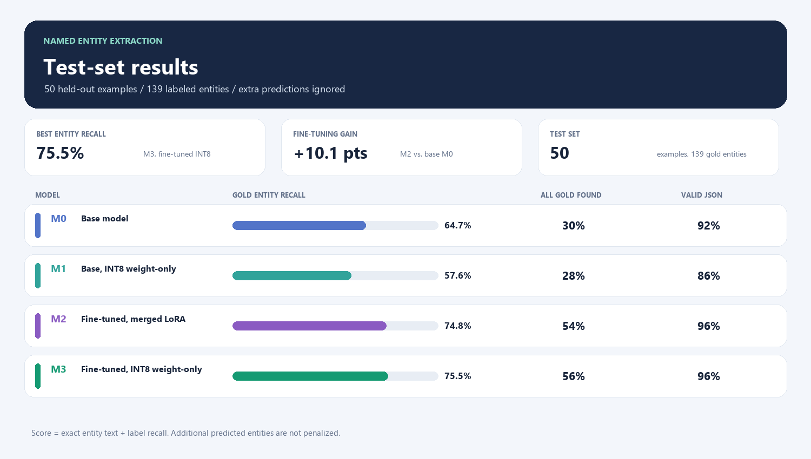
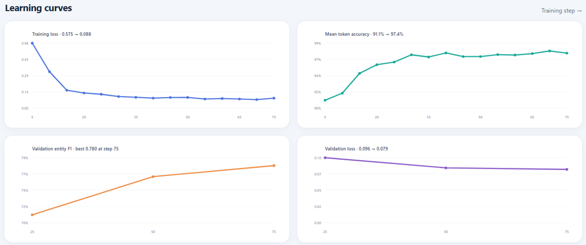
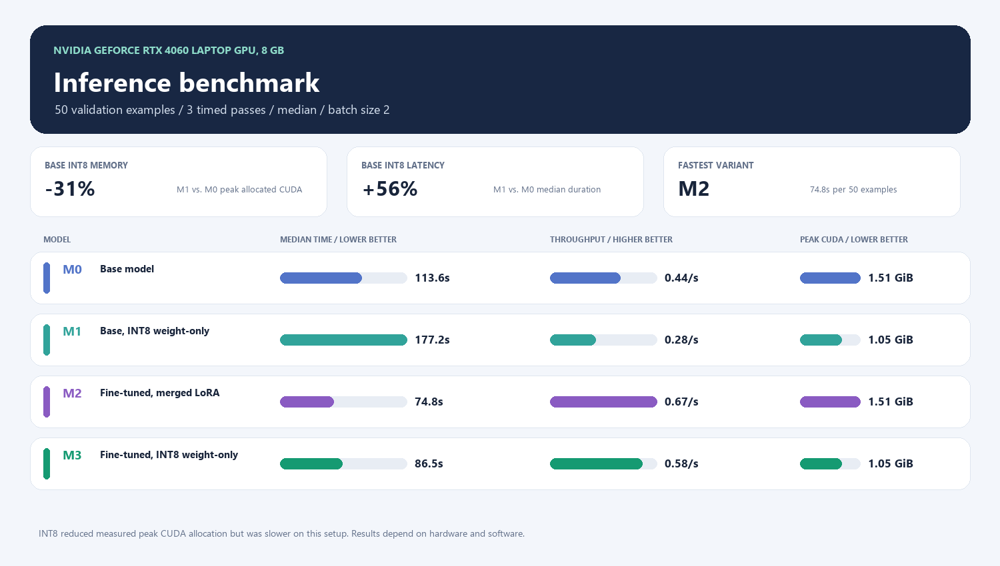

# Learn LLM Quantization and Build an End-to-End Learning Repository

A small, reproducible learning project that follows a language model through data preparation, LoRA fine-tuning, INT8 weight-only quantization, test evaluation, and an inference benchmark. The task is named entity extraction: given a sentence, the model returns labeled entities as JSON.

The project uses [Qwen/Qwen3.5-0.8B-Base](https://huggingface.co/Qwen/Qwen3.5-0.8B-Base). Its base checkpoint is loaded using its saved dtype (mostly BF16 in the local run), so this project does not treat the starting model as FP32.

## Results at a glance

The comparison charts in `assets/` summarize the saved metrics and benchmark results. The original screenshots are kept in `images/`.

### Held-out test results



The test split has 50 examples and 139 labeled entities. Entity recall matches an entity only when both its text and label are exact. As requested for this project, extra predicted entities are not penalized. `All gold found` is the share of sentences where the model captured every labeled entity. `Valid JSON` is the share of outputs that parse into the expected JSON shape.

| Variant | Model | Gold entities captured | Recall | All gold found | Valid JSON |
| --- | --- | ---: | ---: | ---: | ---: |
| M0 | Base model | 90 / 139 | 64.7% | 15 / 50 (30%) | 92% |
| M1 | Base + INT8 weight-only | 80 / 139 | 57.6% | 14 / 50 (28%) | 86% |
| M2 | Fine-tuned, merged LoRA | 104 / 139 | 74.8% | 27 / 50 (54%) | 96% |
| M3 | Fine-tuned + INT8 weight-only | 105 / 139 | 75.5% | 28 / 50 (56%) | 96% |

Fine-tuning (M2) raised gold entity recall by 10.1 percentage points over M0. M3 captured one more labeled entity than M2 on this 50-example test set, a very small difference; it does not establish that quantization improves quality. M1 scored lower than the unquantized base model.

### Training run



The plot records the 75-step LoRA run. Training loss fell from 0.575 to 0.088, and the validation entity F1 peaked at 0.780 at step 75. Token accuracy and language-model loss are training diagnostics; they are not the held-out test score. The validation entity F1 also uses a different scoring setup from the recall-focused test metric above, so compare the four variants using the test table.

### Inference benchmark



| Variant | Median for 50 examples | Throughput | Peak allocated CUDA memory |
| --- | ---: | ---: | ---: |
| M0 | 113.6 s | 0.44 examples/s | 1.51 GiB |
| M1 | 177.2 s | 0.28 examples/s | 1.05 GiB |
| M2 | 74.8 s | 0.67 examples/s | 1.51 GiB |
| M3 | 86.5 s | 0.58 examples/s | 1.05 GiB |

This run used an NVIDIA GeForce RTX 4060 Laptop GPU with 8 GB of memory, 50 validation examples, batch size 2, one warm-up, and three timed passes (median reported). INT8 reduced measured peak allocated CUDA memory by about 31% for the base model, but ran slower in this setup. Treat these as measurements for this specific hardware and software stack, not general performance guarantees.

## What M0 to M3 mean

| ID | Model used | Purpose |
| --- | --- | --- |
| M0 | Original Qwen base checkpoint | Unmodified comparison baseline |
| M1 | M0 with INT8 weight-only quantization | Measure quantization on the base model |
| M2 | M0 fine-tuned with LoRA, then merged | Measure fine-tuning without quantization |
| M3 | M2 with INT8 weight-only quantization | Measure quantization on the fine-tuned model |

The quantization uses TorchAO `Int8WeightOnlyConfig` through Transformers. In short, weights are stored/used in 8-bit form while activations remain at 16-bit precision for this configuration.

## Data and redistribution

The experiment is based on the NYT relation-extraction corpus associated with [Riedel et al. (2010)](https://www.riedelcastro.org/publications/papers/riedel10modeling.pdf). The corpus contains New York Times article text. This repository does not redistribute the source corpus, derived sentence splits, entity schema, or per-example predictions because their redistribution rights have not been established here. Those files are ignored by Git and remain local if already present.

To run the workflow, obtain the source splits through a source you are authorized to use and place `train.json`, `valid.json`, and `test.json` under `Data/dataset/`. The files are expected to be JSON Lines in the source format. Then run the curation step below to create the local splits under `Data/curated/`.

The curated experiment uses these split sizes:

- `train.json`: 300 examples
- `valid.json`: 50 examples
- `test.json`: 50 examples

Each curated row contains a split-unique `sentId`, the sentence text, and labeled entity mentions. The training script removes duplicate sentence text that appears in validation before training. The test split is held out for final comparisons.

## Run the workflow

Run commands from the repository root in PowerShell. The model runs use a CUDA GPU and can take several minutes. Training and evaluation scripts display progress and elapsed time.

### 1. Install dependencies

Use a Python version supported by the PyTorch release you install. First install a matching PyTorch build using the [official PyTorch install selector](https://pytorch.org/get-started/locally/), then install the project packages:

```powershell
python -m pip install -r requirements.txt
```

The recorded local run used Python 3.15.0, PyTorch 2.14.1+cu132, Transformers 5.20.2, TRL 1.16.0, PEFT 0.21.2, and TorchAO 0.17 or newer. These versions are recorded for context; package and CUDA wheel availability depends on the Python version and platform.

### 2. Prepare the curated data

```powershell
python src\0_data_curation.py
```

### 3. Train the LoRA adapter

```powershell
python -u src\2_train_ner_lora.py
```

The script trains for up to 75 steps on the available curated training rows, evaluates generated entities on validation data every 25 steps, and saves the best adapter to `outputs/best_adapter/`. It may stop early if validation entity F1 does not improve at two checks in a row.

### 4. Merge the adapter and create quantized variants

```powershell
python -u src\4_merge_ner_lora.py
python -u src\5_quantize_ner.py --variant M1
python -u src\5_quantize_ner.py --variant M3
```

M1 quantizes the base checkpoint. M3 quantizes the merged fine-tuned checkpoint. The merged checkpoint is saved as `outputs/M2_merged/`.

### 5. Evaluate all variants on the test set

Run each command once. Each evaluates all 50 test rows and writes predictions and a metrics JSON file under `outputs/`.

```powershell
python -u src\3_evaluate_ner.py --variant M0
python -u src\3_evaluate_ner.py --variant M1
python -u src\3_evaluate_ner.py --variant M2
python -u src\3_evaluate_ner.py --variant M3
python src\6_analyze_ner_results.py
```

The aggregate metrics are saved in `results/summary.csv`. The evaluation uses deterministic generation. A run on a specific variant requires that model to be available locally or from Hugging Face; M1, M2, and M3 are created by the preceding steps.

### 6. Benchmark inference

```powershell
python -u src\7_benchmark_ner.py --variant M0
python -u src\7_benchmark_ner.py --variant M1
python -u src\7_benchmark_ner.py --variant M2
python -u src\7_benchmark_ner.py --variant M3
```

Each command writes `results/benchmark_M*.json`. The scripts report progress and elapsed time. The summary charts and training plot used above are included in `assets/`.

## Repository map

```text
Data/
  dataset/       Original source splits
  curated/       Small train/validation/test splits used in this experiment
src/             Curation, training, merge, quantization, evaluation, benchmark scripts
assets/          README figures and quantization learning diagrams
images/          Original results, benchmark, and training screenshots
outputs/         Generated adapters, checkpoints, predictions, and training plot
results/         Compact metric and benchmark summaries
Questions.md     Learning notes and questions
```

Generated checkpoints, source data, curated splits, the entity schema, and per-example predictions are excluded by `.gitignore`. Compact aggregate metrics, benchmark JSON, scripts, and README figures are included. Keep the ignored checkpoint folders locally if you want to rerun evaluation without repeating training or quantization. To reproduce results, supply your authorized local dataset and run the workflow above.

## Repository description

Suggested GitHub description (within GitHub's short description field):

> End-to-end LLM quantization learning project: LoRA fine-tuning, INT8 weight-only quantization, NER evaluation, and inference benchmarks.

## Official references

- [Qwen3.5-0.8B-Base model card](https://huggingface.co/Qwen/Qwen3.5-0.8B-Base)
- [TRL supervised fine-tuning trainer](https://huggingface.co/docs/trl/sft_trainer)
- [PEFT LoRA reference](https://huggingface.co/docs/peft/package_reference/lora)
- [PEFT merge adapter weights](https://huggingface.co/docs/peft/developer_guides/checkpoint#merge-the-weights)
- [Transformers TorchAO quantization](https://huggingface.co/docs/transformers/main/quantization/torchao)
- [Transformers chat templates](https://huggingface.co/docs/transformers/chat_templating)
- [PyTorch installation selector](https://pytorch.org/get-started/locally/)
- [PyTorch CUDA timing and memory notes](https://docs.pytorch.org/docs/stable/notes/cuda.html)
